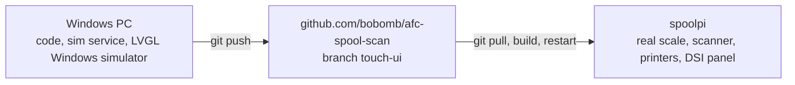

# Spool Station Touch UI — Development Plan

How to build the touch UI. **What** to build (decisions, functions, layout)
lives in [touch-ui-plan.md](touch-ui-plan.md); that file wins on conflict.

Development happens on a Windows PC (VS Code + GitHub Copilot) using simulated
hardware. Code is pushed to the fork and pulled onto `spoolpi` for real-hardware
testing and deployment.

Keep this file current: tick tasks when done, add findings to
[§10 Notes](#10-notes-and-findings), and record decisions in the product
plan's decision log.

---

## 1. Workflow



| Item | Value |
|---|---|
| Repository | `https://github.com/bobomb/afc-spool-scan` (fork of `kekiefer/afc-spool-scan`) |
| Working branch | `touch-ui` (based on `spool-weight`) |
| spoolpi checkout | `/home/pi/afc-spool-scan`, remotes `origin` (upstream) and `fork` (bobomb) |
| spoolpi address | `192.0.2.10` (user `pi`, SSH key access) |
| Spoolman (from LAN) | `http://192.0.2.10:7912/api/v1` |
| Kilo Moonraker | `http://192.0.2.11:7125` |
| Yankee Moonraker | `http://192.0.2.12:7125` |

spoolpi keeps running the existing `usb-qr-scanner.service` (bash) until the
cutover task [P4](#p--spoolpi-deployment).

## 2. Windows environment

Install (PowerShell):

```powershell
winget install --id Git.Git
winget install --id Python.Python.3.13
winget install --id Kitware.CMake
winget install --id Microsoft.VisualStudio.2022.BuildTools --override "--add Microsoft.VisualStudio.Workload.VCTools --includeRecommended --passive"
```

Reuse existing installations when available. Visual Studio 2022 Community
with the C++ build tools and a Windows SDK satisfies the Build Tools
requirement; a second Visual Studio installation is not needed.

VS Code extensions: C/C++, CMake Tools, Python, GitHub Copilot Chat.

Clone and prepare:

```powershell
git config --global core.autocrlf false
git clone https://github.com/bobomb/afc-spool-scan.git
cd afc-spool-scan
git checkout touch-ui
py -3.13 -m venv .venv
.\.venv\Scripts\Activate.ps1
pip install -e ".[dev]"
```

`.gitattributes` forces LF line endings; bash and Python scripts run on spoolpi
and break with CRLF.

## 3. Target repository layout

```
afc-spool-scan/
├─ station/                    Python spool-station service
│  ├─ __main__.py              python -m station
│  ├─ app.py                   wires state, sims/hardware, clients, actions, IPC
│  ├─ config.py                config.env + env vars + CLI flags
│  ├─ state.py                 state model and change notifications
│  ├─ ipc.py                   TCP NDJSON server (§5)
│  ├─ qr.py                    spool ID extraction (port of bash parser)
│  ├─ rules.py                 weight acceptance, sanity check (pure)
│  ├─ actions.py               lookup, weigh, load, assign, empty, undo
│  ├─ scanflow.py              scan modes immediate / countdown / fill
│  ├─ activity.py              activity log + undo records (JSONL)
│  ├─ settings.py              UI-changeable settings (JSON)
│  ├─ audio.py                 wraps audible-cue.py; no-op on Windows
│  ├─ spoolman.py              Spoolman REST client
│  ├─ moonraker.py             Moonraker WebSocket client
│  ├─ printers.py              all printers, target resolution
│  ├─ scale/{dymo.py,source.py,hidraw.py,sim.py}
│  ├─ scanner/{keymap.py,evdev_reader.py,sim.py}
│  ├─ sim/printers.py          fixture-driven fake Moonraker + AFC
│  ├─ sim/spoolman.py          fixture-driven fake Spoolman
│  ├─ sim/fixtures/            printers/*.json, spoolman/spools.json
│  ├─ simcontrol.py            sim.* IPC actions
│  └─ simctl.py                python -m station.simctl (drive simulation)
├─ tests/                      pytest
├─ ui/                         LVGL C++ application
│  ├─ CMakeLists.txt, CMakePresets.json, lv_conf.h
│  ├─ src/{main.cpp, app.cpp, platform_*.cpp, ipc_client.cpp, model.cpp, theme.cpp, screens/, widgets/}
│  ├─ tests/                   doctest unit tests
│  ├─ samples/*.json           sample states for snapshot mode
│  └─ scripts/tour.script      scripted screenshot tour
├─ scripts/{capture-fixtures.py, make-ui-samples.py, install-spoolpi.sh, deploy-spoolpi.ps1}
├─ systemd/{spool-station.service, spool-station-ui.service, README.md}
├─ pyproject.toml
└─ existing scripts (usb-qr-scanner-read.sh, spool-scale-update.sh, dymo-scale-read.py, audible-cue.py, …)
```

Existing scripts must keep working unchanged until cutover.
`dymo-scale-read.py` now imports `station/scale/dymo.py` (standard library
only), so the `station/` directory must stay next to it.

## 4. Runtime modes and safety

| Setting (CLI / `config.env`) | Values | Windows default | spoolpi default |
|---|---|---|---|
| `--hardware` / `STATION_HARDWARE` | `sim`, `real` | `sim` | `real` |
| `--printers` / `STATION_PRINTERS` | `sim`, `live` | `sim` | `live` |
| `--spoolman` / `STATION_SPOOLMAN` | `sim`, `live` | `sim` | `live` |
| `--writes` / `STATION_WRITES` | `off`, `on` | `off` | `on` |
| `--ipc-host` / `STATION_IPC_HOST` | address | `127.0.0.1` | `127.0.0.1` |
| `--ipc-port` / `STATION_IPC_PORT` | port | `7913` | `7913` |
| `--state-dir` / `STATION_STATE_DIR` | path | `%LOCALAPPDATA%\spool-station` | `~/.local/state/spool-station` |
| `--log-level` / `STATION_LOG_LEVEL` | `DEBUG`…`ERROR` | `INFO` | `INFO` |
| `--sim-fixtures` / `STATION_SIM_FIXTURES` | fixture dir | built-in synthetic | — |
| `SPOOLMAN_URL` | URL | `http://192.0.2.10:7912/api/v1` for live reads | `http://127.0.0.1:7912/api/v1` |
| `PRINTERS` | `Name=host:port,…` | `Kilo=192.0.2.11:7125,Yankee=192.0.2.12:7125` | same |

Precedence: platform defaults < `config.env` < environment < CLI flags.

- `--writes off` logs Spoolman writes and G-code instead of sending them to
  **live** services; actions return `ok: true` with `dry_run: true` and a
  "Dry run: …" message, and dry-run activity entries are not undoable.
  Reads (spool lookup, printer subscriptions) still work against live
  services. Simulated services (`sim`) are in-memory and always accept writes.
  A second guard sits in the clients: with writes off the Moonraker client
  only sends `server.info` and `printer.objects.list/query/subscribe`, and the
  Spoolman client only sends `GET`.
- Never enable `--writes on` against the real printers from Windows except for
  a deliberate test with a known spare spool.
- Tests never touch the network; they use mocks and fixtures.
- `PRINTERS` supersedes `MOONRAKER_HOSTS`; if absent, fall back to
  `MOONRAKER_HOSTS` with the host as the display name.
- `config.env` is git-ignored and machine-specific; keep
  `config.env.example` updated with every new key.

Simulation control (`python -m station.simctl`):

```text
simctl scale 984.0            # stable reading in grams
simctl scale 12.5 --oz        # stable reading reported in ounces
simctl scale --status motion  # fault|zero|motion|stable|under|over|calibrate|rezero|absent
simctl scan WEB+SPOOLMAN:S-97 # inject a QR scan
simctl printer kilo --disconnect / --connect
simctl printer yankee --lane lane2 --spool 97 --status Ready
simctl printer kilo --insert lane4       # AFC tags it with the pending spool
simctl printer kilo --restart            # Klipper restart (clears pending)
simctl printer yankee --print printing --progress 0.4
simctl printer yankee --error "lane4 jam" / --clear-error
simctl spoolman --offline / --online
simctl request weigh '{"spool_id": 97}'    # any protocol action
simctl state [topic]                       # print the snapshot
```

`simctl` uses the same IPC port; `sim.*` actions exist only for simulated
components.

## 5. IPC protocol v1

TCP on `127.0.0.1:7913`, UTF-8 newline-delimited JSON, one object per line.
TCP (not a Unix socket) so the same code runs on Windows, where Python's
asyncio has no Unix socket support.

### 5.1 Messages

| Direction | `type` | Purpose |
|---|---|---|
| S→UI | `hello` | `{"type":"hello","protocol":1,"service_version":"…"}` on connect |
| S→UI | `snapshot` | Full state after `hello` and after reconnect |
| S→UI | `event` | `{"type":"event","topic":"<topic>","data":{…}}` incremental update |
| UI→S | `request` | `{"type":"request","id":"u-12","action":"<action>","args":{…}}` |
| S→UI | `result` | `{"type":"result","id":"u-12","ok":true,"message":"…","activity_id":"…"}` |

Event topics: `scale`, `scan`, `spool`, `printer`, `activity`, `health`,
`settings`. The `data` of a topic event replaces that topic's subtree in the
snapshot; a `printer` event carries one printer and replaces the entry in
`printers` with the same `key`.

`hello` also carries `hardware`, `printers`, `spoolman` (`sim`/`real`/`live`)
and `writes`. Requests run concurrently; events caused by a request are sent
before its `result`. Malformed lines get a `result` with `id: null` (or the
request's id) and `code: invalid_args`; the connection stays open. Lines over
1 MiB close the connection.

### 5.2 State snapshot

```json
{
  "scale": {"present": true, "status": "stable", "grams": 984.0, "source_unit": "g"},
  "scan": {"last_code": "WEB+SPOOLMAN:S-97", "spool_id": 97, "at": "2026-10-13T21:00:00Z"},
  "spool": {
    "id": 97, "vendor": "Sunlu", "name": "ABS White", "material": "ABS",
    "color": "#FFFFFF", "remaining_g": 454.7, "spool_weight_g": 180.0,
    "expected_gross_g": 634.7, "location": null, "last_used": "2026-10-01T07:16:18Z",
    "archived": false, "low_stock": false
  },
  "printers": [
    {
      "name": "Kilo", "connected": true, "print_state": "complete",
      "progress": 1.0, "afc_state": "Idle", "afc_error": null,
      "current_load": "lane2", "pending_spool": 97,
      "lanes": [
        {"lane": "lane1", "map": "T0", "spool_id": 84, "material": "PLA",
         "color": "#FFFFFF", "remaining_g": 888.0, "filament_status": "Ready",
         "tool_loaded": false, "low_stock": false}
      ]
    }
  ],
  "health": {"spoolman": true, "scale": true, "scanner": true},
  "activity": [
    {"id": "a-41", "at": "…", "action": "weigh_load", "spool_id": 97,
     "printers": ["Kilo"], "ok": true, "message": "984 g saved; next spool set", "undoable": true}
  ],
  "settings": {
    "target": "both", "scan_mode": "immediate", "theme": "dark",
    "sanity_threshold_g": 50, "sanity_threshold_pct": 10,
    "low_stock_g": 100, "undo_depth": 20, "idle_dim_s": 120, "idle_off_s": 300
  }
}
```

Scale `status` values: `absent`, `fault`, `zero`, `motion`, `stable`,
`under`, `over`, `calibrate`, `rezero` (HID status bytes per product plan
§6.3).

Additive fields implemented beyond the example above (all protocol 1):

| Subtree | Fields |
|---|---|
| `service` | `version`, `protocol`, `hardware`, `printers`, `spoolman`, `writes`, `dry_run` (writes off with a live service) |
| `scale` | `stable`; derived against the current spool: `tare_g`, `net_g`, `expected_g`, `delta_g`, `check` (`ok`, `warn`, `tare_unknown` or null) — the sanity rule stays in the service |
| `scan` | `countdown` `{spool_id, action, remaining_s}` (published each second) and `prompt` `{kind: "confirm_weigh", spool_id, message, gross_g, tare_g, net_g, expected_g, delta_g}` when an immediate scan skipped saving a suspicious weight |
| `spool` | `found` (false → `{id, found, message}` only), `initial_weight_g`, `used_weight_g`, `tare_source` (`spool`, `filament`, `vendor`) |
| `printers[]` | `key`, `klippy_state`, `filename`, `pending_confirmed`; lanes add `status`, `prep`, `load` |
| `health` | `scale_status` |
| `activity[]` | `code`, `dry_run`, `undone`; `action` may also be `scan`, `clear_pending`, `undo` |
| `result` | `code`, `dry_run`, `data` (e.g. sanity figures with `needs_confirm`) |

### 5.3 Actions

| `action` | `args` | Effect |
|---|---|---|
| `lookup` | `spool_id` | Fetch spool from Spoolman → `spool` event |
| `weigh` | `spool_id`, `confirm?` | Stable weight > 50 g → `PUT /spool/{id}/measure` |
| `weigh_load` | `spool_id`, `target?`, `confirm?` | `weigh` then `load` |
| `load` | `spool_id`, `target?` | `SET_NEXT_SPOOL_ID` on target printer(s); track pending |
| `clear_pending` | `printer` | Clear pending next spool on one printer |
| `assign_lane` | `spool_id`, `printer`, `lane` | `SET_SPOOL_ID LANE=… SPOOL_ID=…` |
| `empty_spool` | `spool_id`, `confirm?` | Stable weight → `spool_weight`, archive |
| `undo` | `activity_id` | Revert an undoable activity |
| `set_setting` | `key`, `value` | Persist a setting → `settings` event |
| `cancel_countdown` | — | Cancel a pending scan-mode countdown |
| `dismiss_prompt` | — | Clear `scan.prompt` without saving the weight |
| `sim.scale` / `sim.scan` / `sim.printer` / `sim.spoolman` | see `simcontrol.py` | Drive simulated components (`simctl`) |

`target` is a printer key (`kilo`, `yankee`) or `both`; omitted means the
`target` setting. When the sanity check (§6.4) fails, the result is
`{"ok":false,"code":"needs_confirm","message":"…","data":{…}}` and the UI
re-sends with `"confirm":true`. `empty_spool` also answers `needs_confirm`
when the measured weight is far from the known tare. Error `code`s:
`scale_unavailable`, `scale_unstable`, `below_minimum`, `not_found`,
`printer_offline`, `printer_error` (AFC `!!` response), `spoolman_error`,
`needs_confirm`, `invalid_args`, `undo_failed`, `internal_error`;
`writes_disabled` is reserved (writes-off runs succeed as dry runs).

Behaviour notes: `load` and `assign_lane` refuse spools Spoolman reports as
missing but proceed when Spoolman is unreachable (parity with scanning).
`assign_lane` refuses a spool already in another lane of that printer (AFC
would reject it). A scan in `immediate` mode skips saving when the scale has
no qualifying weight or the sanity check fails, but still loads (parity);
an unknown spool aborts the scan.

Version rule: additive changes keep `protocol: 1`; breaking changes bump it
and the UI shows "incompatible service".

## 6. Service design notes

### 6.1 Concurrency

Single asyncio event loop. Hardware readers run as tasks (blocking reads via
`loop.add_reader` on Linux). State store emits topic change events to all IPC
clients.

### 6.2 Hardware

- **Scale:** move `decode_report`, unit conversion and HID discovery from
  `dymo-scale-read.py` into `station/scale/dymo.py`; the CLI script imports it
  so `spool-scale-update.sh` keeps working. Poll continuously; publish on
  change, max ~5 Hz. Map every HID status (product plan §6.3), not only
  stable.
- **Scanner:** port the keycode/shift mapping from `usb-qr-scanner-read.sh`
  to python-evdev (`evdev` is a Linux-only dependency). Grab the device
  (`EVIOCGRAB`) so scans don't leak into the console or the UI.
- Linux-only modules are imported lazily so Windows can run `--hardware sim`.

### 6.3 Moonraker

- WebSocket `ws://<host>:<port>/websocket`, JSON-RPC.
- On connect: `server.info`; when Klippy is ready, `printer.objects.list`
  then `printer.objects.subscribe` with `AFC`, every `AFC_stepper <lane>` or
  `AFC_lane <lane>` object (lane order from `AFC.lanes`), `print_stats`,
  `display_status`; handle `notify_status_update`,
  `notify_klippy_ready/disconnected/shutdown`, `notify_gcode_response`.
- Commands via `printer.gcode.script`; `!! …` responses received while the
  command runs are treated as errors (AFC logs errors instead of raising).
- Pending next spool is not in AFC status: set on `SET_NEXT_SPOOL_ID`, confirm
  from `notify_gcode_response` `Spool ID set for next load: '<id>'` or
  `Spool ID '<old>' being overwritten for next load: '<id>'` (from any
  sender), clear when a lane's `spool_id` changes to that ID, on
  `clear_pending` (`SET_NEXT_SPOOL_ID` without `SPOOL_ID`) or when Klippy
  disconnects/restarts.
- Reconnect with backoff (1 s → 30 s); mark printer offline meanwhile.

### 6.4 Rules

- Weigh accepts only `stable` readings > `SCALE_MINIMUM_WEIGHT_GRAMS` (50).
- Sanity check: expected gross = spool `spool_weight` (fallback filament
  `spool_weight`, then vendor `empty_spool_weight`, as Spoolman resolves it)
  + `remaining_weight`; require confirmation when
  `|measured − expected| > max(sanity_threshold_g, sanity_threshold_pct% of expected)`.
  Skip the check if no tare is known, but flag "tare unknown".
- Undo records store previous values: `used_weight` (and `initial_weight` when
  Spoolman reset it) for weigh, previous lane `spool_id` (assign), previous
  pending ID (load/clear), previous `spool_weight`, `used_weight` and
  `archived` (empty spool). Undo runs the inverse steps newest first. Only
  entries recorded under the current write mode can be undone.
- Scan handling by `scan_mode`:
  - `immediate`: today's behaviour — weigh if a qualifying weight is present,
    then load to the target.
  - `countdown`: fill the ID, run `weigh_load` after 5 s unless cancelled.
  - `fill`: fill the ID and look it up only.
- Audio cues as today: `weigh` when a weight is saved, `success`, `error`.

### 6.5 Provisional defaults

Open questions in the product plan get these defaults, implemented as
settings so they can change without code edits:

| Setting | Default |
|---|---|
| `target` | `both` (parity with today) |
| `scan_mode` | `immediate` (parity with today) |
| `theme` | `dark` |
| Sanity threshold | 50 g or 10%, whichever is larger |
| `low_stock_g` | 100 |
| `undo_depth` | 20 |
| Idle | dim 120 s, blank 300 s |
| Empty spool minimum weight | > 10 g stable |

## 7. UI design notes

- C++20 on LVGL's C API, LVGL **v9.6.0** pinned via CMake `FetchContent`;
  nlohmann/json and doctest pinned the same way. Use LVGL v9 APIs only.
- Backends chosen by `-DSTATION_UI_BACKEND=`:
  - `windows`: LVGL Windows driver (`LV_USE_WINDOWS`,
    `lv_windows_create_display`, `lv_windows_acquire_pointer_indev`) — no SDL
    needed.
  - `sdl`: `LV_USE_SDL` (Linux/WSL desktop, optional).
  - `drm`: `LV_USE_LINUX_DRM` + `LV_USE_EVDEV` on spoolpi (card path and touch
    event device configurable; confirm in panel bring-up).
- Window/display fixed at 800×480; 32-bit colour
  (`LV_COLOR_FORMAT_DEFAULT LV_COLOR_FORMAT_XRGB8888`).
- Single thread: poll the IPC socket from an `lv_timer` (non-blocking, ~20 ms);
  reconnect every 2 s and show "service offline" until connected. The Windows
  driver runs its message loop on a second thread, so the `windows` backend
  uses `LV_USE_OS LV_OS_WINDOWS` (required by `LV_USE_WINDOWS`).
- Widgets are refreshed from the model by topic bitmask (no observer subjects
  were needed).
- Fonts: Montserrat 16/22/28/48 (48 for scale digits); LVGL symbols for icons.
  The built-in fonts are ASCII + symbols only, so the UI avoids characters
  such as `≈`, `·` or `⚠` (uses `~`, `|`, `LV_SYMBOL_WARNING`).
- Theme: default theme extended with custom styles; minimum touch target
  64 px; pressed and `CHECKED` state styles; lane swatches from AFC colours.
  Changing the `theme` setting rebuilds the widget tree.
- In the simulator, PC keyboard digits/Backspace/Enter/Esc drive the numpad
  (keypad indev bound to a private group; buttons stay out of the default
  group).
- Snapshot mode: `station-ui --snapshot <dir> --state <file.json>` renders the
  screens listed in the sample (`ui/samples/*.json`, generated by
  `scripts/make-ui-samples.py` from the simulated service) to PNG without a
  service; `--connect` uses the running service instead, and `--script` runs
  taps, keys, protocol requests and shots (`ui/scripts/tour.script`). Works in
  every backend build (headless display + virtual pointer); CTest renders all
  samples.
- Layout and screens: product plan §5.

## 8. Tasks

Task IDs are referenced in commits (e.g. `S3: IPC server`). Do tasks in order
within a phase unless noted. Each task ends with tests/build passing.

### W — Windows environment

- [x] **W1** Install toolchain (§2).
- [x] **W2** Clone fork, check out `touch-ui`, create venv.
- [x] **W3** `pytest` runs (no tests yet is fine).

### R — Repository scaffolding

- [x] **R1** Create layout (§3), `pyproject.toml` (deps: `aiohttp`; extras
  `dev`: `pytest`, `pytest-asyncio`; `linux`: `evdev`), `.gitignore` for
  `.venv/`, `ui/build*/`, `__pycache__/`, update `config.env.example` with new
  keys (§4).
- [x] **R2** Move DYMO decoding into `station/scale/dymo.py`;
  `dymo-scale-read.py` imports it with identical CLI and output. Tests for
  grams, ounces, negative exponent, short report, every status byte.
- [x] **R3** `station/qr.py` port of `extract_spool_id` with tests:
  `web+spoolman:s-97`, `WEB+SPOOLMAN:S-97`, URL `/spool/show/97`,
  uppercase URL, non-numeric rejected.
- [x] **R4** `scripts/capture-fixtures.py`: save AFC, `AFC_stepper` lanes,
  `print_stats`, `display_status` for both printers and three Spoolman spools
  (normal, low stock, archived) into `station/sim/fixtures/`. Run once from
  Windows over LAN and commit the fixtures.
  *Captured read-only on 2026-10-14 into `station/sim/fixtures/captured/`
  (both printers; spools 46, 61, 70, 84, 18, 32, 99 in lanes, 31 low stock,
  2 archived). The synthetic fixtures stay the default for deterministic
  tests; `--sim-fixtures station/sim/fixtures/captured` runs the simulators
  on the real data, and `tests/test_captured_fixtures.py` is a contract test.*

### S — Station service

- [x] **S1** `config.py`: parse `config.env` (`KEY="value"`), env overrides,
  CLI flags (§4); Windows-safe paths (`%LOCALAPPDATA%\spool-station`,
  Linux `~/.local/state/spool-station`).
- [x] **S2** `state.py`: typed state (dataclasses) matching §5.2, topic change
  notifications.
- [x] **S3** `ipc.py`: protocol v1 server (§5) with tests using an asyncio
  client (hello → snapshot → event → request/result, malformed line
  handling, multiple clients).
- [x] **S4** Scale: `sim.py` + `hidraw.py` (Linux), status mapping, change
  publishing.
- [x] **S5** Scanner: `sim.py` + `evdev_reader.py` (Linux, grab, keymap with
  shift).
- [x] **S6** `spoolman.py`: get spool, measure, patch; writes guard; tests
  with mocked HTTP.
- [x] **S7** `moonraker.py` + `sim/printers.py`: subscribe, status merge,
  reconnect, G-code with writes guard, pending tracking (§6.3); tests with a
  fake WebSocket server.
- [x] **S8** `actions.py` + `activity.py`: `lookup`, `weigh`, `weigh_load`,
  `load` with rules (§6.4), result codes, activity log persistence.
- [x] **S9** Scan handling in `immediate` mode at parity with
  `usb-qr-scanner-read.sh`; audio cues via `audio.py`.
- [x] **S10** `simctl.py` (§4).
- [x] **S11** `python -m station` on Windows with `--hardware sim --printers sim`
  and with `--printers live --writes off`; documented in README.
  *Both verified (2026-10-14); see §10.*

### U — UI

- [x] **U1** `ui/` CMake project, `CMakePresets.json` (`windows`, `sdl`, `pi`),
  LVGL v9.6.0 + nlohmann/json + doctest via FetchContent, `lv_conf.h`,
  `platform_windows.cpp`; 800×480 window opens. Build:
  `cmake --preset windows` then `cmake --build --preset windows`.
- [x] **U2** `theme.cpp`: dark theme (light variant behind a setting), fonts,
  shared styles.
- [x] **U3** `ipc_client.cpp` + `model.cpp`: connect, parse hello/snapshot/events,
  send requests, reconnect, "service offline" overlay.
- [x] **U4** Main screen (product plan §5.1): header with health dots and tabs,
  scale tile, numpad, spool card, target selector, Weigh / Weigh + Load / Load,
  result banner with Undo.
- [x] **U5** Printers screen (§5.2): two cards, lanes, pending + Clear, tap lane
  → assign dialog.
- [x] **U6** Log screen (§5.3) with Undo.
- [x] **U7** Settings screen (§5.4) wired to `set_setting`.
- [x] **U8** Snapshot mode (§7) and a sample state file per screen.
- [ ] **U9** `platform_drm.cpp` (DRM + evdev); builds on spoolpi via the `pi`
  preset; snapshot mode runs there.
  *`platform_drm.cpp` written (DRM fbdev buffers, evdev auto-discovery or
  `--touch`, sysfs backlight); not yet compiled on Linux (CI job `pi` or
  spoolpi).*

### F — Features (service + UI)

- [x] **F1** Target selection + pending tracking + `clear_pending` (#1). First
  check AFC source (`SET_NEXT_SPOOL_ID` in AFC-Klipper-Add-On) for how to
  clear; record the syntax in the product plan §6.1.
- [x] **F2** Look-up card fields (#2).
- [x] **F3** Assign to lane (#3); confirm `SET_SPOOL_ID` syntax in AFC source;
  undo restores previous lane spool.
- [x] **F4** Empty spool (#5): stable > 10 g → `PATCH spool_weight`,
  `remaining_weight: 0`, `archived: true`; undo restores.
- [x] **F5** Sanity check + confirm dialog (#6).
- [x] **F6** Undo for all undoable actions (#7).
- [x] **F7** Scan modes `immediate` / `countdown` / `fill` with countdown
  overlay and Cancel (#8).
- [x] **F8** Low-stock highlighting (#9).
- [x] **F9** Health indicators incl. scale status text (#10).
- [x] **F10** Idle dim/blank + wake on touch, scan, scale change (#11); dim
  only if `/sys/class/backlight` exists, otherwise black overlay.

### P — spoolpi deployment

- [ ] **P1** `scripts/install-spoolpi.sh`: apt deps (`build-essential cmake
  ninja-build pkg-config libdrm-dev python3-venv python3-dev`), venv at
  `~/afc-spool-scan/.venv`, `pip install -e ".[linux]"`, build UI with the
  `pi` preset. Idempotent; `--update` skips apt.
  *Written (`bash -n` clean); not run on spoolpi.*
- [ ] **P2** `systemd/spool-station.service` (user service, like the current
  scanner service) and `spool-station-ui.service`. UI needs DRM master and
  `/dev/input` access as `pi` (groups `video`, `render`, `input`);
  verify whether a user service can hold DRM master or a system service with
  `User=` is required; disable the tty1 getty/console cursor if they
  interfere.
  *Units and `systemd/README.md` written; DRM master question open.*
- [ ] **P3** `scripts/deploy-spoolpi.ps1`: from Windows, push the branch, then
  `ssh pi@192.0.2.10` to `git pull --ff-only fork touch-ui`,
  run `install-spoolpi.sh --update` and restart services.
  *Written (`-WhatIf` checked; `try-restart` so it never starts units
  before cutover); not run.*
- [ ] **P4** Cutover: add `PRINTERS`/`STATION_*` keys to spoolpi's
  `config.env`; disable `usb-qr-scanner.service`, enable
  `spool-station.service`; verify a real scan at parity. Rollback: disable
  `spool-station.service`, re-enable `usb-qr-scanner.service`.
- [ ] **P5** Panel bring-up (product plan Phase 0) when the panel is
  connected: DRM connector, touch device, backlight, rotation; then enable
  `spool-station-ui.service`.

### C — Continuous integration (optional)

- [ ] **C1** GitHub Actions: `pytest` on Ubuntu and Windows; build UI with
  `sdl` on Ubuntu and `windows` on Windows.
  *`.github/workflows/ci.yml` added (also `headless` + UI end-to-end and
  `pi` compile check); not run yet because nothing was pushed.*

## 9. Definition of done (per task)

- Tests and builds pass on Windows; Linux-only code paths covered by tests
  with fakes.
- No real Spoolman writes or G-code sent unless deliberately run with
  `--writes on`.
- Existing scripts unaffected (until P4).
- Checkbox ticked here; decisions/answers recorded in the product plan.

## 10. Notes and findings

Append dated notes here (verified API details, gotchas, measurements).

- 2026-10-13: spoolpi already has `cmake`, `ninja` and `gcc` installed (also
  `mingw-w64`, not needed for this plan).
- 2026-10-13 (W1): Windows toolchain was already installed: Git
  2.53.0.windows.4, Python 3.13.7 (`py -3.13`), CMake 3.29.2, Visual Studio
  2022 Community 17.14 with MSVC 19.44.35217.0 and Windows SDK 10.0.26100.0.
  CMake on PATH comes from `C:\Strawberry\c\bin` and supports the
  `Visual Studio 17 2022` generator. An isolated x64 C11 smoke project
  configured, built and passed CTest, including Windows SDK, Winsock,
  User32 and GDI linkage, without network or hardware access.
- 2026-10-13 (W1): Python did not have pytest installed. Ran pytest 9.1.1
  in a temporary Python 3.13 venv: zero tests collected (exit 5), expected
  before R1 adds the test layout. Removed the temporary validation files;
  the repository venv and development dependencies remain W2/R1 work.
- 2026-10-13: AFC v1.1.0 source (`extras/AFC_spool.py`): `SET_NEXT_SPOOL_ID`
  without `SPOOL_ID` clears the pending spool; replies are
  `Spool ID set for next load: '<id>'` or
  `Spool ID '<old>' being overwritten for next load: '<id>'` (`'None'` when
  cleared). `SET_SPOOL_ID LANE=<lane> SPOOL_ID=` clears a lane unless the lane
  has `remember_spool`. `SET_SPOOL_ID` refuses a spool already in another
  lane and AFC errors are `!! …` lines via `notify_gcode_response`, not RPC
  errors. Box Turtle lanes are `AFC_stepper <lane>` objects (other units use
  `AFC_lane <lane>`); `AFC.message` is a `{message, type}` queue popped on
  each status read. `filament_status`: `Ready`, `In Tool`, `Prep`,
  `Not Ready`; lane `status`: `None`, `Loaded`, `Tool Loaded`, ….
- 2026-10-13: Spoolman `PUT /spool/{id}/measure` resolves tare as spool
  `spool_weight` → filament `spool_weight` → vendor `empty_spool_weight`
  (else 0); initial weight as spool then filament `weight` (400 "Initial
  weight is not set." if neither). A measurement above initial + tare resets
  `initial_weight` and sets `used_weight` 0, so weigh undo also restores
  `initial_weight`. `PATCH` rejects `used_weight` together with
  `remaining_weight`.
- 2026-10-13: LVGL v9.6.0 moved public headers to `include/lvgl/`; CMake
  takes `LV_BUILD_CONF_PATH` and the `CONFIG_LV_*` cache variables and would
  otherwise fetch into `ui/.deps` (we set `FETCHCONTENT_BASE_DIR` to the build
  tree). `LV_COLOR_DEPTH` is deprecated: its `#warning` is a hard error in
  MSVC C, so use `LV_COLOR_FORMAT_DEFAULT`. `lv_obj_add_flag/remove_flag` are
  deprecated in favour of `lv_obj_set_hidden()`, `lv_obj_set_clickable()` etc.
  `LV_USE_WINDOWS` requires `LV_USE_OS LV_OS_WINDOWS`; `lv_init()` installs the
  Windows tick and exits the process when the last window closes.
  `LV_LABEL_LONG_MODE_DOTS` only truncates with a fixed label height. The
  Windows keypad delivers characters from `WM_CHAR` only.
- 2026-10-13: Pinned UI dependencies (SHA-256 in `ui/CMakeLists.txt`): LVGL
  v9.6.0 tarball (111 MB), nlohmann/json v3.12.0, doctest v2.5.3. A clean
  configure verified the downloads. Full Windows build of LVGL + UI takes a few
  minutes with MSVC; the UI compiles warning-free at `/W4`.
- 2026-10-13: Verified on Windows with simulated everything: 171 pytest tests
  (service, sims, IPC, scan modes, undo, simctl, capture script, UI
  end-to-end), 13 CTest tests (unit + snapshot of every sample), the Windows
  simulator window (800×480 client area; mouse and keyboard checked by posting
  window messages), and the scripted tour `ui/scripts/tour.script` against
  `python -m station --hardware sim --printers sim --spoolman sim`. No live
  Moonraker or Spoolman calls were made and nothing on spoolpi was changed.
- 2026-10-13 (code review fixes): IPC request tasks belong to the server, so a
  UI disconnect or restart never aborts a half-done write (the result is just
  dropped). Activity entries record the write mode
  (`printers=<sim|live>:<w|ro>,spoolman=…`); entries from another mode are not
  undoable, and an undo whose steps were dry runs is reported as a dry run and
  does not mark the entry undone. G-code timeouts (10 s, e.g. while Klipper
  heats) are `printer_error` "may still apply" results that are recorded with
  their undo step. The UI's "Save anyway" re-sends the original spool ID and
  target, and keys are ignored while a dialog is open.
- 2026-10-14 (S11, R4): Read-only live run from the Windows PC:
  `SPOOLMAN_URL=http://192.0.2.10:7912/api/v1 python -m station --hardware
  sim --printers live --spoolman live --writes off`. Moonraker on both printers
  accepts the WebSocket from the LAN without an API key; both subscribe and
  report AFC Idle, `current_load` lane4, 4 Box Turtle lanes (`AFC_stepper`).
  All 99 Spoolman spools are reachable (23 archived, all with a known tare,
  none multi-colour). Weigh, Weigh + Load, Load and Clear returned dry runs;
  Moonraker's `/server/gcode_store` gained no entries on either printer and
  spool 99 was unchanged in Spoolman (checked with GET before and after).
- 2026-10-14: Real data differs from the synthetic fixtures in ways the UI must
  handle: 21 filament names contain U+2122 (™) and 15 contain U+00A0
  (no-break space), which the built-in Montserrat fonts (ASCII, U+00B0,
  U+2022, symbols) render as boxes, so the UI maps all label text through
  `display_text()`. A loaded but untagged lane (Kilo lane2) reports
  `spool_id: null`, `material: null`, `color: ""` but a stale `weight`
  (539 g); the service ignores the weight and the UI shows "Untagged". Yankee
  lanes report `status: "None"` while `filament_status` is `Ready`, so the UI
  relies on `filament_status`.
