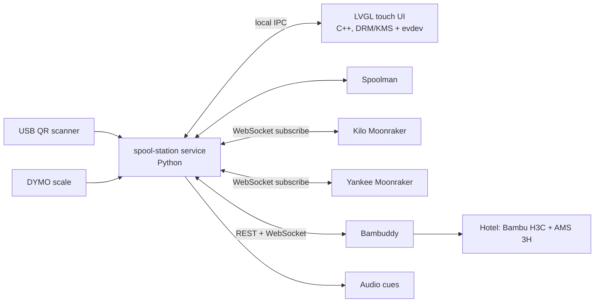

# Spool Station Touch UI — Plan

Source of truth for the touchscreen UI feature. Update this file when a
decision is made or changed, and record it in the [Decision log](#decision-log).
Implementation tasks, protocol and dev setup: [touch-ui-dev-plan.md](touch-ui-dev-plan.md).

Status legend: **Decided** · **Proposed** (default unless changed) · **Open**

---

## 1. Goal

A touch UI on a 7" DSI touchscreen attached to `spoolpi` (the Raspberry Pi that
hosts the USB QR scanner, DYMO scale and Spoolman) to:

- Show live scale weight and status.
- Enter a spool ID with a numeric pad when a spool has no scannable label.
- Run spool functions (weigh, weigh + load, load, and the additional
  functions below).
- Show the current spool/filament state of both AFC printers.

## 2. Environment and constraints

| Item | Value |
|---|---|
| Host | `spoolpi`, Raspberry Pi 4 Model B, 4 GB RAM |
| OS | Debian 13 (trixie) Raspberry Pi OS Lite, `multi-user.target`, no desktop/compositor |
| Disk | ~4.9 GB free (83% used) — keep footprint small |
| Spoolman | Docker, `http://127.0.0.1:7912/api/v1` |
| Printer: Kilo | Moonraker `192.0.2.11:7125`, AFC Box Turtle `Turtle_1`, lanes 1–4 |
| Printer: Yankee | Moonraker `192.0.2.12:7125`, AFC Box Turtle `Turtle_1`, lanes 1–4 |
| Printer: Hotel (added 2026-11-15) | Bambu Lab H3C with an AMS 3H (nine slots), managed by Bambuddy 1.3.1 (Docker on spoolpi, `http://127.0.0.1:8010`, printer id 1); the station uses Bambuddy's REST API and websocket with a scoped API key (§6.4) |
| Name resolution | `.local`/mDNS unreliable on spoolpi — use IP addresses |
| Scale | DYMO M10, USB `0922:8003`, `/dev/hidraw*` via `99-dymo-scale.rules` |
| QR scanner | TMS HID keyboard, `/dev/input/by-id/usb-TMS_HIDKeyBoard_1234567890abcd-event-kbd` |
| Audio | ALSA analog out, `plughw:CARD=Headphones,DEV=0` |
| AFC software | v1.1.0 on both printers |
| Display | Hosyond 7" DSI IPS, 800×480, capacitive touch — see §2.1 |

### 2.1 Display — **Decided**

| Item | Value |
|---|---|
| Panel | Hosyond 7" DSI IPS display |
| Resolution | 800×480, RGB888, 60 Hz |
| Active area | 154.68 × 87.02 mm (≈ 0.19 mm/px; 64 px ≈ 12 mm) |
| Touch | Capacitive; manual shows an FT5x06 controller (`generic ft5x06`, I2C `0x38`) |
| Interface | Raspberry Pi MIPI DSI, 15-pin 1.0 mm FFC; plug-and-play, no driver install |
| Power | 5 V, 510 mA max; via pogo pins (Pi mounted on the panel) or 2-pin cable to Pi header pins 4 (5 V) and 6 (GND) |
| Backlight | Hardware button: short press +10% (cycles), 3 s press turns off; software control via `/sys/class/backlight/10-0045` (0–255, group `video`) — verified 2026-10-14 |

State on spoolpi (2026-10-14, panel connected; read-only inspection):

- Auto-detected with the existing `display_auto_detect=1` and
  `dtoverlay=vc4-kms-v3d`; no overlay change was needed. It enumerates like
  the official Raspberry Pi 7" display (DSI bridge + `panel_disp`).
- DRM: `/dev/dri/card1` (vc4-drm) `DSI-1` connected, one mode `800x480`;
  `card0` is the v3d render node. The console runs on `fb0` (vc4drmfb,
  800×480, 16 bpp) with a getty on tty1.
- Touch: `10-0038 generic ft5x06 (00)` (`edt_ft5x06`, I2C 0x38) at
  `/dev/input/event5`, stable path
  `/dev/input/by-path/platform-fe205000.i2c-event`; multi-touch ABS axes.
- Backlight: `/sys/class/backlight/10-0045`, `max_brightness` 255,
  `brightness` writable by group `video` — software dimming is available.
- `pi` is in `video`, `render` and `input`. Power: `throttled=0x0`
  shortly after boot (recheck under load). 3.8 GB free on `/` (87% used).
- Verified 2026-10-15 with the LVGL UI: rendering on DSI-1 as uid 1000 (DRM
  master on first open), touch device 0–799 × 0–479 (no calibration),
  backlight dim/blank/wake. Tap test by eye (user, 2026-10-15): touch is
  aligned in the current landscape orientation, and a touch wakes the dimmed
  or blank screen to full brightness.

Notes:

- The manual's rotation steps use the desktop Screen Configuration tool, which
  spoolpi does not have. If rotation is needed it is done in LVGL (display and
  touch).
- The panel likely emulates the official Raspberry Pi 7" display (same
  FT5x06 touch at `0x38`). If auto-detect fails, try
  `dtoverlay=vc4-kms-dsi-7inch`.
- Pi 4 + panel + scale + scanner share one supply; use a 5.1 V 3 A supply.

## 3. Architecture — **Decided**



- **spool-station service (Python):** sole owner of the scale and QR scanner
  (no competing readers). Maintains live state, talks to Spoolman, both
  Moonraker instances and Bambuddy, executes actions, plays audio cues,
  records activity. Bambuddy owns the Bambu printer: it pushes the slot
  settings and charges print usage to Spoolman (added 2026-11-15). The
  service talks MQTT to the printer only to send a slot's remaining weight,
  which Bambuddy can't (§6.4, added 2026-11-16).
- **Touch UI (LVGL, C):** stateless view. Renders state pushed by the service
  and sends action requests. No network code beyond local IPC.
- Existing scripts (`dymo-scale-read.py`, `audible-cue.py`) are reused as
  modules; the shell scripts remain as a CLI fallback.

### 3.1 UI technology — **Decided: LVGL, C++**

- LVGL v9.x (v9.6 current at time of decision). The UI is written in C++20
  on top of LVGL's C API (decided 2026-10-13; originally C).
- Renders directly via DRM/KMS with evdev/libinput touch; no compositor or
  browser required.
- Development via the LVGL Windows simulator driver on a Windows PC; same code
  built for the Pi (see §3.3).
- Styling via LVGL styles/states/parts and a custom theme extending the
  default theme; skins swappable at runtime.

Alternatives considered and not chosen: web UI + Chromium/`cage` kiosk,
WPE WebKit (`cog`), Qt/QML (PySide6), Kivy, extending KlipperScreen.

### 3.2 IPC between UI and service — **Proposed**

- TCP on `127.0.0.1:7913` carrying newline-delimited JSON. TCP rather than a
  Unix socket because Python's asyncio has no Unix sockets on Windows, where
  development happens (§3.3).
- Service → UI: full state snapshot on connect, then incremental events
  (scale, printer, spool lookup, action result, activity).
- UI → service: action requests with a request ID; service replies with
  result and pushes resulting state changes.
- UI side JSON parsing via nlohmann/json (C++).
- Message definitions: dev plan §5.

### 3.3 Development workflow — **Decided**

- Software is developed on a Windows PC with VS Code + GitHub Copilot before
  the panel is connected.
- The service runs there with simulated scale/scanner and either simulated
  printers or live printers with writes disabled; the UI runs in the LVGL
  Windows simulator at 800×480.
- Code is pushed to `github.com/bobomb/afc-spool-scan` branch `touch-ui` and
  pulled onto spoolpi for real-hardware testing and deployment.

## 4. Functions

### 4.1 Core functions — **Decided**

| Function | Behaviour |
|---|---|
| Scale display | Live weight in grams (converted from oz if needed), stability/status, estimated net filament |
| Numeric spool ID entry | On-screen numpad; scanning a QR also fills the ID |
| Weigh spool | Read stable scale weight; update Spoolman via `PUT /spool/{id}/measure` |
| Weigh spool + load | Weigh, then send `SET_NEXT_SPOOL_ID` to both printers |
| Load spool | Send `SET_NEXT_SPOOL_ID` to both printers only |
| Printer dashboard | Per-printer lane state (see §6) |

Rules carried over from the current scanner behaviour:

- A weight is only accepted if the scale reports a **stable** reading
  **> 50 g** (`SCALE_MINIMUM_WEIGHT_GRAMS`).
- "Load" means *tag the next lane inserted* on the printer
  (`SET_NEXT_SPOOL_ID`), not physical loading.
- **Decided (2026-10-14):** setting the next loaded spool
  (`SET_NEXT_SPOOL_ID`) is the default assignment, as in the current scripts.
  Scans, Weigh + Load and Load only ever use it. Assigning a spool to a
  specific lane (`SET_SPOOL_ID`, #3) happens only when explicitly chosen:
  **Assign lane…** on the main screen, or tapping a lane on the Printers
  screen, and in both cases confirming with **Assign** in the dialog.
- QR prefixes/URLs are matched case-insensitively.

### 4.2 Additional functions — **Decided** (accepted 2026-10-13)

| # | Function | Notes |
|---|---|---|
| 1 | **Next spool on every printer** | Changed 2026-10-19 (was "Target printer selection: Kilo / Yankee / Both"); extended 2026-11-15 to the Bambu printer. Load and Weigh + Load always set the next spool on every printer; printers cannot be deselected. On the Bambu printer the next spool is *armed* in the service, and the spool is assigned (in Bambuddy) to whichever empty AMS 3H slot it goes into first. When one printer loads that spool, the service clears it as next spool on the other printers (undoable, in the Log). A Bambu printer that is switched off is skipped quietly. The pending next spool per printer is shown with **Clear pending**. |
| 2 | **Look up (no action)** | Enter/scan ID → show vendor, filament name, material, color, remaining, spool weight, location, last used. |
| 3 | **Assign to specific lane** | `SET_SPOOL_ID LANE=laneN SPOOL_ID=X` on a chosen printer/lane; for lanes tagged wrongly or loaded without a scan. Only when explicitly chosen (§4.1: the default is next-spool). |
| 5 | **Record empty spool** | Weigh the empty core, store it as the spool's `spool_weight` (tare) and as its filament's default `spool_weight`, then archive the spool. |
| 6 | **Weight sanity check** | Before saving, show gross, tare, net and the delta from Spoolman's expected weight; warn above a threshold (likely wrong spool or missing tare). |
| 7 | **Undo and recent activity** | Activity list of recent actions; undo restores previous Spoolman values / lane assignment / pending spool. |
| 8 | **Scan behaviour mode** | Configurable behaviour when a QR is scanned while the UI is running (see §7). |
| 9 | **Low-stock highlighting** | Lanes and looked-up spools below a threshold are highlighted. |
| 10 | **Health / connection status** | Spoolman, Kilo, Yankee, Hotel and scale connection indicators; scale status detail. A Bambu printer that is switched off (Bambuddy up, printer off) is shown as "Off", not as a problem; Bambuddy itself unreachable is "offline" like a Moonraker printer. |
| 11 | **Screen idle management** | Blank/dim after idle; wake on touch, scan or scale change. Dimming needs a software backlight (verify, §2.1); otherwise blank to a black screen. When the screen goes off the station goes to sleep: the selected spool is deselected and the pending next spool is cleared on both printers (added 2026-10-19; undoable, in the Log). |

### 4.3 Explicitly excluded — **Decided**

| # | Function | Reason |
|---|---|---|
| 4 | Unload and return to shelf (weigh on removal, clear lane, set location) | Not wanted. |

## 5. Screens and layout — **Decided** (re-layout 2026-10-15; §5.2–5.4 Proposed)

Resolution 800×480 landscape (Hosyond panel, §2.1). Minimum touch target
64 px (≈ 12 mm on this panel), 60 px for the action bar.

### 5.0 Frame

A 72 px side rail on the left: **Station**, **Printers**, **Log** and, at the
bottom, **Settings**. Above Settings, one status line replaces the per-service
dots: "All OK", or the most serious problem first ("Yankee offline", "Scale
off", "Spoolman down") with "+N" for the rest, and "SIM" / "DRY RUN" when
applicable. The last result with **Undo** runs along the bottom of every
screen.

### 5.1 Station (main)

```
┌────┬─────────────────────────────────────────────────────────┐
│ ⌂  │ ┌──────┐ #93 · Polymaker                │ ON SCALE   ⌨ │
│Stat│ │ 701  │ Panchroma Silk Rainbow         │ 841.0 g      │
│ 🖶 │ │g left│ PLA · Dry box B                │ ✓ Matches    │
│Prnt│ └──────┘ 70% left · tare 140 g          │   Spoolman   │
│ ☰  │ PRINTERS · Load sets the next spool on both              │
│Log │ ┌ Kilo  Complete        ┐ ┌ Yankee  Printing 42%     ┐ │
│    │ │ [888g][612g][74g][ – ]│ │ [950g][321g][ ? ][45g]   │ │
│ ●  │ │  PLA  PLA PETG Empty  │ │  PLA PETG Untag ABS      │ │
│AllOK│ │ ↓ Next spool #93      │ │ ↓ Next spool #93          │ │
│    │ [More] [ Weigh ] [ Load ] [     Weigh + Load      ]    │
│ ⚙  │ ✓ Spool 93: 841 g saved; next spool set on…   [Undo]   │
└────┴─────────────────────────────────────────────────────────┘
```

- **Top box (selected spool + scale).** A rounded tile filled with the
  filament colour (a diagonal gradient through every colour of a
  multi-colour spool) carries a ring of remaining filament (% of the
  spool's initial weight) with the grams left inside ("701 g left").
  Next to it: spool #, vendor, name, material, location, the share left
  ("70% left") and tare; on the right the scale
  weight and the Spoolman check ("Matches Spoolman", "Off by +349 g",
  "Scale empty", "Scale off"). Tapping anywhere on the box opens the
  keypad. With no spool selected the box shows a dashed "Type ID" tile,
  "Scan a spool / or tap here to type its ID"; an unknown ID shows "Not
  found in Spoolman".
- **Printer cards.** One card per printer, display only: status, lanes and
  the pending next spool at the bottom. Load always goes to every printer
  (§4.2 #1), so there is no target selection. Cards are ordered as in
  `PRINTERS` (left to right) and titled with the printer name set in
  Mainsail (falling back to the configured name); the same name is used on
  the Printers screen, in the status line and in result messages (2026-10-19).
- **Three printers (decided 2026-11-15, mockup option C).** With a third
  printer (or one with more than four lanes) the cards become two rows of
  compact cards: the two four-lane printers side by side on top, the Bambu
  printer (nine AMS 3H slots) across the full width below. Each card has a
  header column (name, status, ↓ next spool #) and compact tiles: a 34 px
  ring with grams left, then material and spool #; LOW replaces the
  material, an amber dot marks slot settings that apply after the print, the
  loaded lane or slot has a blue outline. With one or two four-lane printers
  the layout above is unchanged. A Bambu printer that is off says "Off" with
  its tiles dimmed.

```
│ PRINTERS · Load sets the next spool on every printer          │
│ ┌ Kilo      [888][612][74][ - ] ┐ ┌ Yankee   [950][321][ ? ][45] ┐ │
│ │ Complete   PLA  PLA PETG Empty│ │ Printing  PLA PETG Untag ABS │ │
│ │ ↓ #93                         │ │ ↓ #93                         │ │
│ ┌ Hotel     [920][410][760][812][ 88][ ? ][530][640][300]          ┐ │
│ │ Printing   PLA  PLA PETG PETG  LOW  no tag PLA ABS TPU          │ │
│ │ ↓ #93                                                            │ │
```
- **Lane tiles.** Each lane is a rounded tile filled with the lane spool's
  colour(s), with its remaining ring (share of the initial weight), grams
  left in the ring ("852 g", "1.2 kg" above 1 kg), material and spool # in
  white or near-black, whichever has the higher contrast (WCAG) on that fill. Low
  stock is an amber "LOW" pill next to the spool #, below the ring. The lane
  loaded in the tool has a blue outline. Empty lanes are a hollow outline;
  untagged lanes a grey tile with "?".
- **Action bar.** **More** (Assign to lane…, Record empty spool), **Weigh**,
  **Load** and **Weigh + Load** (primary). All four are disabled until a
  spool is selected.
- **Keypad.** A sheet over the screen: digits, backspace, **Clear** (also
  deselects the spool, like Esc), **Look up**; × or a tap outside closes it.
  A digit on a hardware keyboard opens it with that digit typed. A scan
  closes it and selects the scanned spool.

### 5.2 Printers

One column per printer (two, or three narrower columns with a third
printer, decided 2026-11-15, mockup option P1). Each shows:

- Connection, print state and progress, AFC `current_state` (Bambu: "AMS
  3H"), AFC error message (Bambu: the HMS warning or error).
- Pending next spool (tracked by the service) with **Clear**. Cleared when
  the printer goes offline, since that usually means it shut down or
  rebooted; when another printer loads that spool into a lane; and when the
  station goes to sleep (§4.2 #1, #11).
- Lanes 1–4: color swatch, material, spool ID, remaining g (bar), tool map
  (T0–T3), `filament_status`, loaded lane highlighted, low-stock highlight.
  The Bambu printer shows its nine AMS 3H slots (`3H-1`…`3H-9`) as a 3×3
  grid of cells filled with the spool colour: slot, spool #, material, grams,
  status or LOW, and the amber settings-pending dot.
- Tapping a lane or slot opens **Assign to lane** with the current spool ID;
  nothing is sent until **Assign** is tapped (§4.1). For the Bambu printer
  Assign sets the slot's spool in Bambuddy.

### 5.3 Log

Recent actions (time, action, spool, printer, result) with **Undo** on
undoable entries.

### 5.4 Settings

Scan mode, thresholds, idle timeout, brightness (only if a software
backlight is available, §2.1), theme/skin. Implemented without the
brightness control.

### 5.5 Styling

- Custom LVGL theme extending the default theme (primary/secondary palette,
  Montserrat 12–48, large digits for scale weight).
- No borders for grouping: filled surfaces and spacing; only the main action
  is filled blue; sentence-case buttons.
- Filament colours come from Spoolman (`color_hex`, or every colour of
  `multi_color_hexes`), falling back to the AFC lane `color`.
- Use shadows/blur sparingly for render performance.
- Dark default with a light theme in Settings.

## 6. Data sources

### 6.1 Moonraker (per printer)

Subscribe via Moonraker WebSocket to:

| Object | Fields used |
|---|---|
| `AFC` | `current_load`, `current_state`, `error_state`, `message`, `lanes`, `units`, `maps` |
| `AFC_stepper lane1`…`lane4` (or `AFC_lane …`) | `spool_id`, `material`, `color`, `weight`, `filament_status`, `status`, `map`, `prep`, `load`, `tool_loaded` |
| `print_stats` | `state`, `filename` |
| `display_status` | `progress` |

Commands (via `POST /printer/gcode/script`):

| Purpose | Command |
|---|---|
| Queue spool for next load | `SET_NEXT_SPOOL_ID SPOOL_ID=<id>` |
| Assign spool to lane | `SET_SPOOL_ID LANE=<lane> SPOOL_ID=<id>` |
| Clear pending next spool | `SET_NEXT_SPOOL_ID` (no `SPOOL_ID`; verified in AFC v1.1.0 `AFC_spool.py`) |

AFC status does **not** expose the pending next-spool ID. The service tracks
what it sent and confirms from `notify_gcode_response` lines
`Spool ID set for next load: '<id>'` or
`Spool ID '<old>' being overwritten for next load: '<id>'` (`'None'` means
cleared). AFC consumes the pending ID when a lane loads. `SET_SPOOL_ID`
refuses a spool already assigned to another lane and reports errors as
`!! …` responses, not as G-code errors.

### 6.2 Spoolman

| Purpose | Endpoint |
|---|---|
| Look up spool | `GET /api/v1/spool/{id}` |
| Record gross weight | `PUT /api/v1/spool/{id}/measure` `{ "weight": <g> }` |
| Set tare / archive / undo | `PATCH /api/v1/spool/{id}` (`spool_weight`, `archived`, `used_weight`) |
| Health | `GET /api/v1/health` |

Expected gross for the sanity check = spool `spool_weight` (fallback: filament
`spool_weight`) + `remaining_weight`.

### 6.4 Bambuddy (Bambu printers, added 2026-11-15)

Bambuddy (`BAMBUDDY_URL`, API key with *read status* and *inventory* scopes
only) owns the printer; the station talks MQTT to it only for the remaining
weight (below). AMS 3H slot *n* is `(ams_id 32, tray_id n-1)`; the station
calls it lane `3H-n`.

| Purpose | Endpoint |
|---|---|
| Printer status (seed) | `GET /api/v1/printers/{id}/status` (`state`, `progress`, `subtask_name`, `hms_errors`, `ams[].tray[]` with `exists`, `tray_type`, `tray_color`, `tray_uuid`; `tray_now` = 28 + slot) |
| Slot → spool map | `GET /api/v1/spoolman/inventory/slot-assignments/all?printer_id={id}` |
| Live updates | `POST /api/v1/auth/ws-token`, then websocket `/api/v1/ws?token=…`: `printer_status`, `spool_assignment_changed`, `unknown_tag` |
| Assign a spool to a slot | `POST /api/v1/spoolman/inventory/slot-assignments` `{spoolman_spool_id, printer_id, ams_id, tray_id, move: true}`; Bambuddy also pushes material, colour and temperatures to the slot |
| Unassign | `DELETE /api/v1/spoolman/inventory/slot-assignments/{spool_id}` |
| Learn an RFID tag | `PATCH /api/v1/spoolman/inventory/spools/{id}/tag` `{tray_uuid}` (409 if another spool has it) |

Behaviour, decided 2026-11-15:

- **Next spool is armed** in the service. When a slot goes from empty to
  filled while armed, the service waits about 3 s for Bambuddy's own RFID
  match, then assigns the armed spool to that slot and clears it as next
  spool on the other printers (one undoable Log entry: undo unassigns the
  slot and arms every printer again).
- **RFID:** a Bambu spool Bambuddy already knows keeps Bambuddy's match. If
  it differs from the armed spool, the Log warns and the spool stays armed
  (warn only, no block). A tag no spool has yet is linked to the armed spool,
  so reinserting it later needs no scan; if the tag belongs to another spool
  nothing is assigned and the Log says so.
- **Slot settings while printing:** the H3C has refused Bambuddy's settings
  push during a print, and has also taken it for a slot the print didn't use
  (2026-11-18). About 10 s after an assignment the service checks the slot.
  If the settings didn't land during a print, the slot is marked
  settings-pending and the assignment is sent once more when the print
  ends. If they didn't land while idle, it is sent once more right away.
  If the slot still differs after that, the Log says so.
- **Off vs offline:** printer switched off (Bambuddy reports it
  disconnected) → "Off", not an error, Load skips it; Bambuddy unreachable →
  offline, an error. Both clear the armed spool.
- Bambuddy's own 120 s auto-unassign of an empty slot is shown, not fought.
  External spool inputs `(255, n)` are not shown (upstream bug, bambuddy
  #3558). An armed spool does not expire; sleep clears it (§4.2 #11).
- Spool details (material, colour, grams left) come from Spoolman; the
  service fetches them again when a print ends, because Bambuddy charges the
  print's usage then.
- **Remaining weight on the printer** (decided 2026-11-16): the service
  sends Spoolman's grams to each assigned slot (`set_filament_weight` over
  the printer's LAN MQTT, as Bambu Studio does; Bambuddy 1.3.1 doesn't), so
  the H3C's own screen shows them. It sends when the printer is idle, after
  the slot's filament settings, and again whenever Spoolman's grams no
  longer match the printer's whole-percent figure (a weigh, a print's usage,
  a spool taken out and put back). Needs the printer's access code
  (`BAMBU_ACCESS_CODE`); without it this is skipped. Bambu RFID spools are
  synced too (user, 2026-11-16), capped at 1000 g left, the printer's limit
  for tagged spools. Also proposed upstream to Bambuddy.

### 6.3 Scale (USB HID POS scale report)

Status byte values to surface in the UI:

| Value | Meaning | UI |
|---|---|---|
| 1 | Fault | Error |
| 2 | Stable at zero | Empty |
| 3 | In motion | Settling |
| 4 | Stable | Ready |
| 5 | Under zero | Re-zero |
| 6 | Over weight | Overload |
| 7 | Requires calibration | Error |
| 8 | Requires re-zeroing | Re-zero |
| — | Device absent | Off / disconnected |

## 7. Behaviour details

| Topic | Status | Value |
|---|---|---|
| Weight acceptance | Decided | Stable reading > 50 g |
| Display orientation | Proposed | Landscape, not rotated (works as currently placed, verified 2026-10-15); if the final mount requires it, rotate in LVGL (display + touch) |
| Target printer default | **Decided** 2026-10-19 | Always every printer; no selection (§4.2 #1; Bambu printer included 2026-11-15) |
| Scan behaviour mode (#8) | Decided: configurable; **Open:** default | Options: *immediate* (current: weigh if possible + load), *fill + countdown* (fill ID, run default action after cancellable countdown), *fill only* |
| Sanity-check warning threshold | **Open** | e.g. 50 g or 10% of expected |
| Low-stock threshold | **Open** | e.g. < 100 g remaining |
| Undo depth | **Open** | e.g. last 20 actions, in memory + persisted |
| Idle blank timeout | **Open** | e.g. 2 min dim, 5 min off |
| Empty spool: also update filament default `spool_weight`? | **Decided** 2026-10-15 | Yes: spool + filament; undo restores both |
| Lane motion commands from UI (eject/unload) | **Open** | Not included unless decided |
| Button labels | **Open** | Keep "Weigh / Weigh + Load / Load" or rename "Load" → "Queue" |
| Remote access (phone/PC) | **Open** | Not provided by LVGL UI; service could expose a page later |

## 8. Migration

- `spool-station.service` (systemd user service) replaces
  `usb-qr-scanner.service`; on first release scan behaviour is identical to
  today (immediate mode, target Both).
- `usb-qr-scanner-read.sh`, `spool-scale-update.sh`, `dymo-scale-read.py` and
  `audible-cue.py` remain usable from the CLI.
- Configuration continues to come from `config.env`.
- UI runs as a separate service (`spool-station-ui.service`) on the DSI
  display; the station service works without it.

## 9. Phases

Detailed tasks: dev plan §8.

| Phase | Scope | Exit criteria | Status |
|---|---|---|---|
| 0. Display bring-up | Connect Hosyond panel; confirm auto-detect (fallback `dtoverlay=vc4-kms-dsi-7inch`); verify DSI DRM connector, FT5x06 touch event device, `/sys/class/backlight` availability and power headroom; LVGL DRM + evdev hello-world | Touch + render verified on spoolpi; backlight capability recorded in §2.1 | Done 2026-10-15 (render, touch alignment, backlight dim/blank/wake; §2.1) |
| 1. Station service | Scale poller, QR scanner (python-evdev), Moonraker subscriptions, Spoolman client, core actions, audio, activity log, IPC; replaces scanner service | Scan parity with current behaviour; unit tests for decoding, QR parsing, actions | Done: in production on spoolpi since 2026-10-15; scan + weigh parity confirmed |
| 2. UI MVP | Main screen: scale, numpad, spool lookup card, target selector, Weigh / Weigh + Load / Load, result banner, health indicators | All core functions usable by touch | Done: Weigh, Load and Undo used by touch on the panel with live services (2026-10-15) |
| 3. Printer dashboard | Printers screen per §5.2; pending spool + Clear; tap lane → assign | Live lane state for both printers | Live on the panel with both printers (2026-10-15) |
| 4. Extended workflows | Assign to lane, empty spool, sanity check, undo + Log screen, low-stock, scan mode setting | Functions #1–3, #5–9 complete | Implemented; undo verified live; assign lane, empty spool and scan modes not yet used on live services |
| 5. Polish | Idle blank/wake, Settings screen, theme/skin, packaging, docs, push to fork | Runs unattended after reboot | Done 2026-10-15: reboot tested; both services started unattended and connected |

## 10. Open questions

1. Theme: dark, light, or toggle.
2. ~~Target printer default.~~ Decided 2026-10-19: always both (§4.2 #1).
3. Scan mode default.
4. Thresholds: sanity-check delta, low stock, idle timeouts.
5. ~~Empty spool: update filament default tare too?~~ Decided 2026-10-15:
   yes (§7).
6. Allow lane motion commands from the UI?
7. Button labels ("Load" vs "Queue").
8. IPC transport: TCP localhost NDJSON proposed (§3.2); confirm.
9. ~~AFC command for clearing a pending next spool.~~ Resolved:
   `SET_NEXT_SPOOL_ID` without `SPOOL_ID` (§6.1).
10. ~~Does the panel expose software backlight control?~~ Resolved
    2026-10-14: yes, `/sys/class/backlight/10-0045` (§2.1).
11. Mounting orientation (landscape assumed; landscape verified on the
    panel as currently placed, 2026-10-15).
12. ~~Main screen re-layout to reduce clutter.~~ Decided 2026-10-15:
    option C (printer cards as the Load target; selection removed 2026-10-19)
    with D's side rail, filled
    lane and spool tiles, tap the top box for the keypad, More menu (§5).
13. ~~Bambu H3C integration (Q1–Q6, 2026-11-15).~~ Decided 2026-11-15:
    layout C (two rows) and Printers P1 (three columns) from mockups; Load
    arms every printer; RFID mismatch warns only; no external inputs in v1;
    an armed spool does not expire; a switched-off Bambu printer is a neutral
    "Off" (§4.2, §5, §6.4).
14. ~~Show Spoolman's remaining grams on the H3C's own screen for untagged
    spools (2026-11-16)?~~ Decided 2026-11-16: both. The station sends
    `set_filament_weight` over the printer's MQTT itself (§6.4), and a
    Bambuddy issue and PR propose sending it with each slot assignment.

## Decision log

| Date | Decision |
|---|---|
| 2026-10-13 | Build a touch UI for the 7" DSI screen on spoolpi. |
| 2026-10-13 | UI technology: LVGL (C), DRM/KMS + evdev, no compositor/browser. |
| 2026-10-13 | Architecture: Python spool-station service owns hardware and integrations; LVGL UI is a thin client over local IPC. |
| 2026-10-13 | Core functions: scale display, numeric ID entry, Weigh, Weigh + Load, Load, printer dashboard. |
| 2026-10-13 | Additional functions accepted: #1 target selection, #2 look up, #3 assign to lane, #5 empty spool, #6 sanity check, #7 undo/activity, #8 scan mode, #9 low stock, #10 health, #11 idle management. |
| 2026-10-13 | Excluded: #4 unload and return to shelf. |
| 2026-10-13 | Display: Hosyond 7" DSI IPS, 800×480 capacitive (FT5x06); UI targets 800×480 landscape. |
| 2026-10-13 | Panel bring-up deferred; develop software first on Windows with simulated hardware and the LVGL Windows simulator; deliver via fork branch `touch-ui`. |
| 2026-10-13 | UI language changed from C to C++20 (LVGL v9.6 C API, nlohmann/json); Rust bindings considered and not chosen (no maintained LVGL 9.6 binding). |
| 2026-10-14 | Default assignment is the next loaded spool (`SET_NEXT_SPOOL_ID`), as the scripts do; lane assignment (`SET_SPOOL_ID`) only when explicitly chosen and confirmed in the Assign dialog. |
| 2026-10-15 | Empty spool also sets the filament's default `spool_weight` to the measured weight (§4.2 #5, §7). |
| 2026-10-15 | Main screen re-layout (§5): side rail with one status line; top box with the selected spool as a filament-coloured tile (gradient for multi-colour spools) with remaining ring, tap to open the keypad; printer cards are the Load target (any subset of printers); lanes as filament-coloured tiles with remaining ring and contrast-picked text; More menu for Assign lane and Empty spool. |
| 2026-10-15 | Lane tiles and the selected spool tile show grams left in the ring centre instead of the percentage; the ring still shows the share left, and the spool details line shows the percentage. |
| 2026-10-16 | A printer going offline (unreachable, Klippy shutdown/disconnect) clears its pending next spool in the service, because it usually means the printer shut down or rebooted. |
| 2026-10-19 | Changes §4.2 #1 (was target selection Kilo / Yankee / Both): Load and Weigh + Load always set the next spool on both printers and printers cannot be deselected (the `target` setting and the card toggle are removed). When a printer loads that spool into a lane, the next spool is cleared on the other printers. |
| 2026-10-19 | §4.2 #11: when the screen goes off the station goes to sleep: deselect the spool and clear the pending next spool on both printers. |
| 2026-10-19 | §5.1: printers are shown by their Mainsail printer name (configured name as fallback), and the card order follows `PRINTERS` (on the station: Yankee left, Kilo right). |
| 2026-11-15 | Bambu H3C (Hotel) joins through Bambuddy (§2, §3, §6.4): the station uses Bambuddy's API only; the next spool is armed in the service and assigned to the AMS 3H slot the spool goes into. |
| 2026-11-15 | Changes §4.2 #1 (user, Q2): Load and Weigh + Load arm the Bambu printer too ("every printer"). |
| 2026-11-15 | Changes §5 (user, Q1, from mockups): with three printers the station screen uses two rows of compact cards (option C) and the Printers screen three columns with a 3×3 slot grid (option P1); one or two four-lane printers keep the current layout. |
| 2026-11-15 | User, Q3–Q6: no external inputs in v1; an RFID spool that differs from the scan only warns; an armed spool does not expire; a switched-off Bambu printer is a neutral "Off" that Load skips. |
| 2026-11-15 | Bambuddy writes have their own switch (`BAMBUDDY_WRITES`), so the Bambu printer can start read-only while the Vorons keep writing. |
| 2026-11-16 | User (open question 14): show Spoolman's grams on the H3C itself. The station sends `set_filament_weight` over the printer's MQTT (needs `BAMBU_ACCESS_CODE`), and Bambuddy is asked upstream (issue + PR) to send it with slot assignments. Changes §6.4 "the station never talks MQTT". |
| 2026-11-16 | User: Bambu RFID spools get Spoolman's grams too, not the printer's own estimate (capped at 1000 g left, the H3C's limit for tagged spools; its profile allows RFID edits). |
