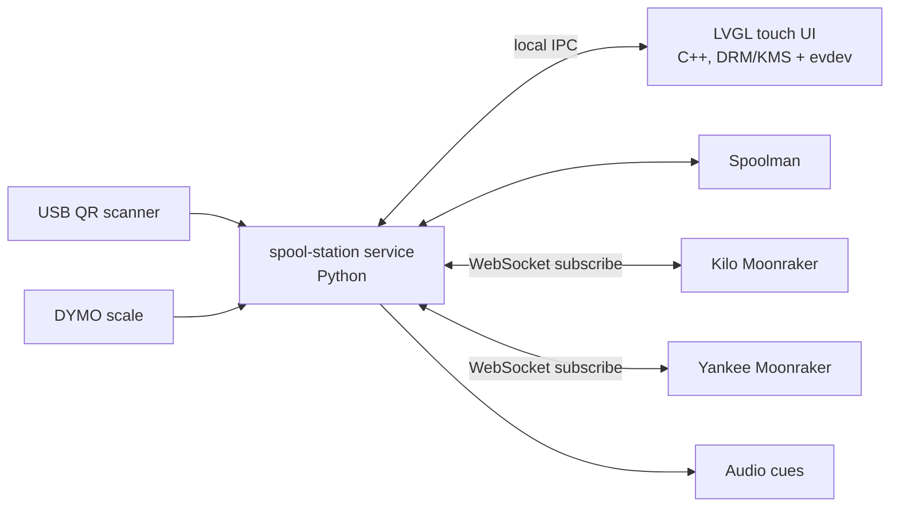

# Spool Station Touch UI — Plan

Source of truth for the touchscreen UI feature. Update this file when a
decision is made or changed, and record it in the [Decision log](#decision-log).
Implementation tasks, protocol and dev setup: [touch-ui-dev-plan.md](touch-ui-dev-plan.md).

Status legend: **Decided** · **Proposed** (default unless changed) · **Open**

---

## 1. Goal

A touch UI on a 7" DSI touchscreen attached to `spoolpi` (the Raspberry Pi that
hosts the USB QR scanner, DYMO scale and Spoolman) to:

- Show live scale weight and status.
- Enter a spool ID with a numeric pad when a spool has no scannable label.
- Run spool functions (weigh, weigh + load, load, and the additional
  functions below).
- Show the current spool/filament state of both AFC printers.

## 2. Environment and constraints

| Item | Value |
|---|---|
| Host | `spoolpi`, Raspberry Pi 4 Model B, 4 GB RAM |
| OS | Debian 13 (trixie) Raspberry Pi OS Lite, `multi-user.target`, no desktop/compositor |
| Disk | ~4.9 GB free (83% used) — keep footprint small |
| Spoolman | Docker, `http://127.0.0.1:7912/api/v1` |
| Printer: Kilo | Moonraker `192.0.2.11:7125`, AFC Box Turtle `Turtle_1`, lanes 1–4 |
| Printer: Yankee | Moonraker `192.0.2.12:7125`, AFC Box Turtle `Turtle_1`, lanes 1–4 |
| Name resolution | `.local`/mDNS unreliable on spoolpi — use IP addresses |
| Scale | DYMO M10, USB `0922:8003`, `/dev/hidraw*` via `99-dymo-scale.rules` |
| QR scanner | TMS HID keyboard, `/dev/input/by-id/usb-TMS_HIDKeyBoard_1234567890abcd-event-kbd` |
| Audio | ALSA analog out, `plughw:CARD=Headphones,DEV=0` |
| AFC software | v1.1.0 on both printers |
| Display | Hosyond 7" DSI IPS, 800×480, capacitive touch — see §2.1 |

### 2.1 Display — **Decided**

| Item | Value |
|---|---|
| Panel | Hosyond 7" DSI IPS display |
| Resolution | 800×480, RGB888, 60 Hz |
| Active area | 154.68 × 87.02 mm (≈ 0.19 mm/px; 64 px ≈ 12 mm) |
| Touch | Capacitive; manual shows an FT5x06 controller (`generic ft5x06`, I2C `0x38`) |
| Interface | Raspberry Pi MIPI DSI, 15-pin 1.0 mm FFC; plug-and-play, no driver install |
| Power | 5 V, 510 mA max; via pogo pins (Pi mounted on the panel) or 2-pin cable to Pi header pins 4 (5 V) and 6 (GND) |
| Backlight | Hardware button: short press +10% (cycles), 3 s press turns off; software control via `/sys/class/backlight/10-0045` (0–255, group `video`) — verified 2026-10-14 |

State on spoolpi (2026-10-14, panel connected; read-only inspection):

- Auto-detected with the existing `display_auto_detect=1` and
  `dtoverlay=vc4-kms-v3d`; no overlay change was needed. It enumerates like
  the official Raspberry Pi 7" display (DSI bridge + `panel_disp`).
- DRM: `/dev/dri/card1` (vc4-drm) `DSI-1` connected, one mode `800x480`;
  `card0` is the v3d render node. The console runs on `fb0` (vc4drmfb,
  800×480, 16 bpp) with a getty on tty1.
- Touch: `10-0038 generic ft5x06 (00)` (`edt_ft5x06`, I2C 0x38) at
  `/dev/input/event5`, stable path
  `/dev/input/by-path/platform-fe205000.i2c-event`; multi-touch ABS axes.
- Backlight: `/sys/class/backlight/10-0045`, `max_brightness` 255,
  `brightness` writable by group `video` — software dimming is available.
- `pi` is in `video`, `render` and `input`. Power: `throttled=0x0`
  shortly after boot (recheck under load). 3.8 GB free on `/` (87% used).
- Verified 2026-10-15 with the LVGL UI: rendering on DSI-1 as uid 1000 (DRM
  master on first open), touch device 0–799 × 0–479 (no calibration),
  backlight dim/blank/wake. Still to verify by eye: touch alignment and
  orientation.

Notes:

- The manual's rotation steps use the desktop Screen Configuration tool, which
  spoolpi does not have. If rotation is needed it is done in LVGL (display and
  touch).
- The panel likely emulates the official Raspberry Pi 7" display (same
  FT5x06 touch at `0x38`). If auto-detect fails, try
  `dtoverlay=vc4-kms-dsi-7inch`.
- Pi 4 + panel + scale + scanner share one supply; use a 5.1 V 3 A supply.

## 3. Architecture — **Decided**



- **spool-station service (Python):** sole owner of the scale and QR scanner
  (no competing readers). Maintains live state, talks to Spoolman and both
  Moonraker instances, executes actions, plays audio cues, records activity.
- **Touch UI (LVGL, C):** stateless view. Renders state pushed by the service
  and sends action requests. No network code beyond local IPC.
- Existing scripts (`dymo-scale-read.py`, `audible-cue.py`) are reused as
  modules; the shell scripts remain as a CLI fallback.

### 3.1 UI technology — **Decided: LVGL, C++**

- LVGL v9.x (v9.6 current at time of decision). The UI is written in C++20
  on top of LVGL's C API (decided 2026-10-13; originally C).
- Renders directly via DRM/KMS with evdev/libinput touch; no compositor or
  browser required.
- Development via the LVGL Windows simulator driver on a Windows PC; same code
  built for the Pi (see §3.3).
- Styling via LVGL styles/states/parts and a custom theme extending the
  default theme; skins swappable at runtime.

Alternatives considered and not chosen: web UI + Chromium/`cage` kiosk,
WPE WebKit (`cog`), Qt/QML (PySide6), Kivy, extending KlipperScreen.

### 3.2 IPC between UI and service — **Proposed**

- TCP on `127.0.0.1:7913` carrying newline-delimited JSON. TCP rather than a
  Unix socket because Python's asyncio has no Unix sockets on Windows, where
  development happens (§3.3).
- Service → UI: full state snapshot on connect, then incremental events
  (scale, printer, spool lookup, action result, activity).
- UI → service: action requests with a request ID; service replies with
  result and pushes resulting state changes.
- UI side JSON parsing via nlohmann/json (C++).
- Message definitions: dev plan §5.

### 3.3 Development workflow — **Decided**

- Software is developed on a Windows PC with VS Code + GitHub Copilot before
  the panel is connected.
- The service runs there with simulated scale/scanner and either simulated
  printers or live printers with writes disabled; the UI runs in the LVGL
  Windows simulator at 800×480.
- Code is pushed to `github.com/bobomb/afc-spool-scan` branch `touch-ui` and
  pulled onto spoolpi for real-hardware testing and deployment.

## 4. Functions

### 4.1 Core functions — **Decided**

| Function | Behaviour |
|---|---|
| Scale display | Live weight in grams (converted from oz if needed), stability/status, estimated net filament |
| Numeric spool ID entry | On-screen numpad; scanning a QR also fills the ID |
| Weigh spool | Read stable scale weight; update Spoolman via `PUT /spool/{id}/measure` |
| Weigh spool + load | Weigh, then send `SET_NEXT_SPOOL_ID` to the target printer(s) |
| Load spool | Send `SET_NEXT_SPOOL_ID` to the target printer(s) only |
| Printer dashboard | Per-printer lane state (see §6) |

Rules carried over from the current scanner behaviour:

- A weight is only accepted if the scale reports a **stable** reading
  **> 50 g** (`SCALE_MINIMUM_WEIGHT_GRAMS`).
- "Load" means *tag the next lane inserted* on the printer
  (`SET_NEXT_SPOOL_ID`), not physical loading.
- **Decided (2026-10-14):** setting the next loaded spool
  (`SET_NEXT_SPOOL_ID`) is the default assignment, as in the current scripts.
  Scans, Weigh + Load and Load only ever use it. Assigning a spool to a
  specific lane (`SET_SPOOL_ID`, #3) happens only when explicitly chosen:
  **Assign lane…** on the main screen, or tapping a lane on the Printers
  screen, and in both cases confirming with **Assign** in the dialog.
- QR prefixes/URLs are matched case-insensitively.

### 4.2 Additional functions — **Decided** (accepted 2026-10-13)

| # | Function | Notes |
|---|---|---|
| 1 | **Target printer selection** | Kilo / Yankee / Both. Show the pending next-spool per printer and allow **Clear pending**. Fixes stale pending IDs left on the printer not loaded. |
| 2 | **Look up (no action)** | Enter/scan ID → show vendor, filament name, material, color, remaining, spool weight, location, last used. |
| 3 | **Assign to specific lane** | `SET_SPOOL_ID LANE=laneN SPOOL_ID=X` on a chosen printer/lane; for lanes tagged wrongly or loaded without a scan. Only when explicitly chosen (§4.1: the default is next-spool). |
| 5 | **Record empty spool** | Weigh the empty core, store it as the spool's `spool_weight` (tare), then archive the spool. |
| 6 | **Weight sanity check** | Before saving, show gross, tare, net and the delta from Spoolman's expected weight; warn above a threshold (likely wrong spool or missing tare). |
| 7 | **Undo and recent activity** | Activity list of recent actions; undo restores previous Spoolman values / lane assignment / pending spool. |
| 8 | **Scan behaviour mode** | Configurable behaviour when a QR is scanned while the UI is running (see §7). |
| 9 | **Low-stock highlighting** | Lanes and looked-up spools below a threshold are highlighted. |
| 10 | **Health / connection status** | Spoolman, Kilo, Yankee and scale connection indicators; scale status detail. |
| 11 | **Screen idle management** | Blank/dim after idle; wake on touch, scan or scale change. Dimming needs a software backlight (verify, §2.1); otherwise blank to a black screen. |

### 4.3 Explicitly excluded — **Decided**

| # | Function | Reason |
|---|---|---|
| 4 | Unload and return to shelf (weigh on removal, clear lane, set location) | Not wanted. |

## 5. Screens and layout — **Proposed**

Resolution 800×480 landscape (Hosyond panel, §2.1). Minimum touch target
64 px (≈ 12 mm on this panel).

### 5.1 Main

```
┌──────────────────────────────────────────────────────────────┐
│ ●Spoolman ●Kilo ●Yankee ●Scale   [Main][Printers][Log]  ⚙  │
├───────────────────────┬──────────────────────────────────────┤
│ SCALE  984.0 g ✓      │ SPOOL [ 97              ⌫ ]          │
│ filament ≈ 804 g      │ ■ Sunlu ABS White · 455 g left       │
├───────────────────────┤ ⚠ measured differs by +349 g         │
│   7     8     9       ├──────────────────────────────────────┤
│   4     5     6       │ Target: [Kilo] [Yankee] [Both]      │
│   1     2     3       │ [WEIGH] [WEIGH + LOAD] [LOAD]        │
│   C     0     ⏎       │ [Assign lane…] [Empty spool]         │
├───────────────────────┴──────────────────────────────────────┤
│ ✓ Spool 97: 984 g saved · next spool set on Kilo   [Undo]  │
└──────────────────────────────────────────────────────────────┘
```

### 5.2 Printers

Two cards (Kilo, Yankee). Each shows:

- Connection, print state and progress, AFC `current_state`, AFC error message.
- Pending next spool (tracked by the service) with **Clear**.
- Lanes 1–4: color swatch, material, spool ID, remaining g (bar), tool map
  (T0–T3), `filament_status`, loaded lane highlighted, low-stock highlight.
- Tapping a lane opens **Assign to lane** with the current spool ID; nothing
  is sent until **Assign** is tapped (§4.1).

### 5.3 Log

Recent actions (time, action, spool, printer, result) with **Undo** on
undoable entries.

### 5.4 Settings

Target printer default, scan mode, thresholds, idle timeout, brightness
(only if a software backlight is available, §2.1), theme/skin.
Implemented without the brightness control, which waits for Phase 0 to show
whether `/sys/class/backlight` exists.

### 5.5 Styling

- Custom LVGL theme extending the default theme (primary/secondary palette,
  font sizes small/normal/large, large digits for scale weight).
- State styles: pressed feedback, `CHECKED` outline for the selected target.
- Lane swatches use AFC lane `color` values.
- Use shadows/blur sparingly for render performance.
- **Open:** dark, light, or both with a toggle.

## 6. Data sources

### 6.1 Moonraker (per printer)

Subscribe via Moonraker WebSocket to:

| Object | Fields used |
|---|---|
| `AFC` | `current_load`, `current_state`, `error_state`, `message`, `lanes`, `units`, `maps` |
| `AFC_stepper lane1`…`lane4` (or `AFC_lane …`) | `spool_id`, `material`, `color`, `weight`, `filament_status`, `status`, `map`, `prep`, `load`, `tool_loaded` |
| `print_stats` | `state`, `filename` |
| `display_status` | `progress` |

Commands (via `POST /printer/gcode/script`):

| Purpose | Command |
|---|---|
| Queue spool for next load | `SET_NEXT_SPOOL_ID SPOOL_ID=<id>` |
| Assign spool to lane | `SET_SPOOL_ID LANE=<lane> SPOOL_ID=<id>` |
| Clear pending next spool | `SET_NEXT_SPOOL_ID` (no `SPOOL_ID`; verified in AFC v1.1.0 `AFC_spool.py`) |

AFC status does **not** expose the pending next-spool ID. The service tracks
what it sent and confirms from `notify_gcode_response` lines
`Spool ID set for next load: '<id>'` or
`Spool ID '<old>' being overwritten for next load: '<id>'` (`'None'` means
cleared). AFC consumes the pending ID when a lane loads. `SET_SPOOL_ID`
refuses a spool already assigned to another lane and reports errors as
`!! …` responses, not as G-code errors.

### 6.2 Spoolman

| Purpose | Endpoint |
|---|---|
| Look up spool | `GET /api/v1/spool/{id}` |
| Record gross weight | `PUT /api/v1/spool/{id}/measure` `{ "weight": <g> }` |
| Set tare / archive / undo | `PATCH /api/v1/spool/{id}` (`spool_weight`, `archived`, `used_weight`) |
| Health | `GET /api/v1/health` |

Expected gross for the sanity check = spool `spool_weight` (fallback: filament
`spool_weight`) + `remaining_weight`.

### 6.3 Scale (USB HID POS scale report)

Status byte values to surface in the UI:

| Value | Meaning | UI |
|---|---|---|
| 1 | Fault | Error |
| 2 | Stable at zero | Empty |
| 3 | In motion | Settling |
| 4 | Stable | Ready |
| 5 | Under zero | Re-zero |
| 6 | Over weight | Overload |
| 7 | Requires calibration | Error |
| 8 | Requires re-zeroing | Re-zero |
| — | Device absent | Off / disconnected |

## 7. Behaviour details

| Topic | Status | Value |
|---|---|---|
| Weight acceptance | Decided | Stable reading > 50 g |
| Display orientation | Proposed | Landscape, not rotated; if the mount requires it, rotate in LVGL (display + touch) |
| Target printer default | **Open** | Both / last used / require choice |
| Scan behaviour mode (#8) | Decided: configurable; **Open:** default | Options: *immediate* (current: weigh if possible + load), *fill + countdown* (fill ID, run default action after cancellable countdown), *fill only* |
| Sanity-check warning threshold | **Open** | e.g. 50 g or 10% of expected |
| Low-stock threshold | **Open** | e.g. < 100 g remaining |
| Undo depth | **Open** | e.g. last 20 actions, in memory + persisted |
| Idle blank timeout | **Open** | e.g. 2 min dim, 5 min off |
| Empty spool: also update filament default `spool_weight`? | **Open** | Spool-only vs spool + filament |
| Lane motion commands from UI (eject/unload) | **Open** | Not included unless decided |
| Button labels | **Open** | Keep "Weigh / Weigh + Load / Load" or rename "Load" → "Queue" |
| Remote access (phone/PC) | **Open** | Not provided by LVGL UI; service could expose a page later |

## 8. Migration

- `spool-station.service` (systemd user service) replaces
  `usb-qr-scanner.service`; on first release scan behaviour is identical to
  today (immediate mode, target Both).
- `usb-qr-scanner-read.sh`, `spool-scale-update.sh`, `dymo-scale-read.py` and
  `audible-cue.py` remain usable from the CLI.
- Configuration continues to come from `config.env`.
- UI runs as a separate service (`spool-station-ui.service`) on the DSI
  display; the station service works without it.

## 9. Phases

Detailed tasks: dev plan §8.

| Phase | Scope | Exit criteria | Status |
|---|---|---|---|
| 0. Display bring-up | Connect Hosyond panel; confirm auto-detect (fallback `dtoverlay=vc4-kms-dsi-7inch`); verify DSI DRM connector, FT5x06 touch event device, `/sys/class/backlight` availability and power headroom; LVGL DRM + evdev hello-world | Touch + render verified on spoolpi; backlight capability recorded in §2.1 | Render, touch device and backlight verified on spoolpi (2026-10-15); tap test by eye pending |
| 1. Station service | Scale poller, QR scanner (python-evdev), Moonraker subscriptions, Spoolman client, core actions, audio, activity log, IPC; replaces scanner service | Scan parity with current behaviour; unit tests for decoding, QR parsing, actions | Implemented and tested with simulated hardware/printers/Spoolman; parity on spoolpi pending cutover (P4) |
| 2. UI MVP | Main screen: scale, numpad, spool lookup card, target selector, Weigh / Weigh + Load / Load, result banner, health indicators | All core functions usable by touch | Implemented; verified in the Windows simulator and headless screenshots |
| 3. Printer dashboard | Printers screen per §5.2; pending spool + Clear; tap lane → assign | Live lane state for both printers | Implemented against simulated printers; live printers not yet connected |
| 4. Extended workflows | Assign to lane, empty spool, sanity check, undo + Log screen, low-stock, scan mode setting | Functions #1–3, #5–9 complete | Implemented (simulated services) |
| 5. Polish | Idle blank/wake, Settings screen, theme/skin, packaging, docs, push to fork | Runs unattended after reboot | Idle, Settings, light/dark theme done; install/systemd/deploy scripts written, not deployed |

## 10. Open questions

1. Theme: dark, light, or toggle.
2. Target printer default.
3. Scan mode default.
4. Thresholds: sanity-check delta, low stock, idle timeouts.
5. Empty spool: update filament default tare too?
6. Allow lane motion commands from the UI?
7. Button labels ("Load" vs "Queue").
8. IPC transport: TCP localhost NDJSON proposed (§3.2); confirm.
9. ~~AFC command for clearing a pending next spool.~~ Resolved:
   `SET_NEXT_SPOOL_ID` without `SPOOL_ID` (§6.1).
10. ~~Does the panel expose software backlight control?~~ Resolved
    2026-10-14: yes, `/sys/class/backlight/10-0045` (§2.1).
11. Mounting orientation (landscape assumed).

## Decision log

| Date | Decision |
|---|---|
| 2026-10-13 | Build a touch UI for the 7" DSI screen on spoolpi. |
| 2026-10-13 | UI technology: LVGL (C), DRM/KMS + evdev, no compositor/browser. |
| 2026-10-13 | Architecture: Python spool-station service owns hardware and integrations; LVGL UI is a thin client over local IPC. |
| 2026-10-13 | Core functions: scale display, numeric ID entry, Weigh, Weigh + Load, Load, printer dashboard. |
| 2026-10-13 | Additional functions accepted: #1 target selection, #2 look up, #3 assign to lane, #5 empty spool, #6 sanity check, #7 undo/activity, #8 scan mode, #9 low stock, #10 health, #11 idle management. |
| 2026-10-13 | Excluded: #4 unload and return to shelf. |
| 2026-10-13 | Display: Hosyond 7" DSI IPS, 800×480 capacitive (FT5x06); UI targets 800×480 landscape. |
| 2026-10-13 | Panel bring-up deferred; develop software first on Windows with simulated hardware and the LVGL Windows simulator; deliver via fork branch `touch-ui`. |
| 2026-10-13 | UI language changed from C to C++20 (LVGL v9.6 C API, nlohmann/json); Rust bindings considered and not chosen (no maintained LVGL 9.6 binding). |
| 2026-10-14 | Default assignment is the next loaded spool (`SET_NEXT_SPOOL_ID`), as the scripts do; lane assignment (`SET_SPOOL_ID`) only when explicitly chosen and confirmed in the Assign dialog. |
